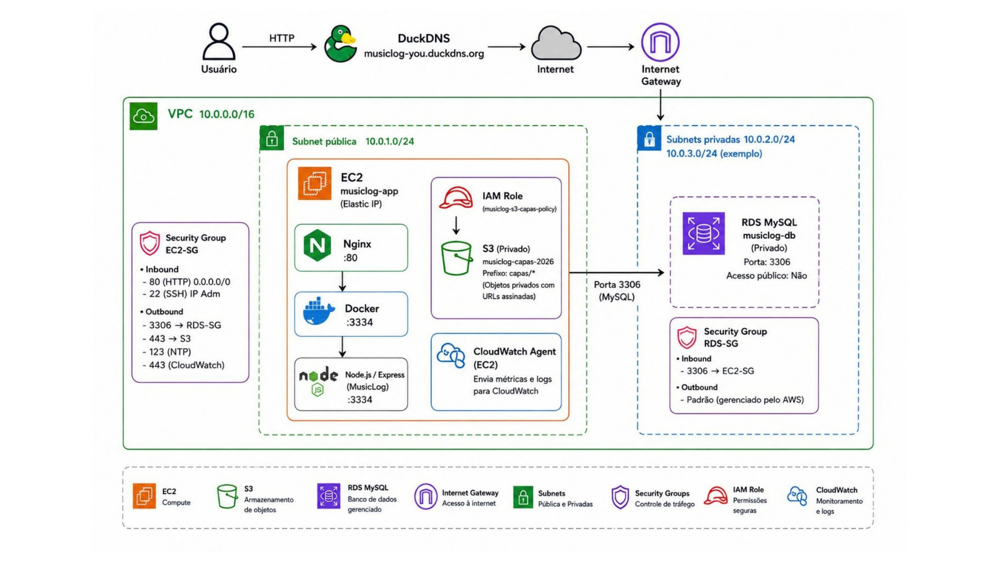

---

# MusicLog
 
> Aplicação web para registrar, organizar e acessar uma coleção de músicas pessoal.
 

 
---
 
## Sobre o projeto
 
O MusicLog é uma aplicação web utilizada como base para um desafio de infraestrutura em nuvem, desenvolvido durante meu período de estágio.

O objetivo foi provisionar uma arquitetura na Amazon Web Services (AWS), realizar o deploy da aplicação e compreender o funcionamento de cada serviço, desde a hospedagem até a segurança e o monitoramento.

Ao final, a arquitetura e as decisões técnicas foram apresentadas à equipe, consolidando os conhecimentos adquiridos durante o desafio.  
  
## Arquitetura AWS

O ambiente foi estruturado para integrar a aplicação web aos serviços de infraestrutura da AWS, priorizando organização, segurança e monitoramento.

---

## Componentes da infraestrutura
 
| Serviço/Tecnologia | Responsabilidade |
|------------|----------|
| Amazon EC2 | Hospedagem da aplicação|
| Amazon RDS (MySQL) | Persistência dos dados|
| Amazon S3 | Armazenamento das capas musicais|
| IAM Role | Acesso seguro da EC2 ao S3, sem Access Keys no código|
| Docker | Containerização da aplicação|
| Nginx | Proxy reverso para a aplicação|
| DuckDNS | Domínio para acesso ao projeto|
| Amazon CloudWatch | Monitoramento de CPU, memória, disco e armazenamento do RDS|
| VPC e Subnets | Organização e isolamento da infraestrutura|
| Security Groups | Controle de tráfego e acesso aos recursos|

---

 
## </> | Linguagens e Tecnologias (Stack)
 
| Camada | Tecnologia | Descrição |
|--------|------------|----------|
| Frontend |    | HTML para o corpo do site, CSS para o design e Javascript para as funcionalidades|
| Backend |  +  | Servidor que processará as requisições do site, como conexão com o Banco e criação de Gráficos |
| Banco de dados |   +  | Armazenamento e manuseio de dados |
| Cloud e DevOps |  +  +  +  +  +  + | Hospedagem e Infraestrutura da Aplicação|

---
 
## Segurança e infraestrutura

Durante a implementação, foram adotadas práticas para proteger a comunicação entre os serviços:

Banco de dados RDS sem acesso público, com conexões restritas à aplicação.

Bucket S3 privado para armazenamento das capas.

IAM Role associada à EC2, evitando credenciais estáticas no código.

Security Groups para controlar as conexões entre os recursos.

Organização da rede utilizando VPC e subnets públicas e privadas.

---

## Monitoramento

O Amazon CloudWatch foi utilizado para acompanhar o comportamento da infraestrutura, incluindo:

Utilização de CPU da EC2.

Consumo de memória e disco.

Espaço de armazenamento disponível no Amazon RDS.

Alarmes para identificar possíveis problemas de utilização de recursos.
